# Flutter - fundamentos, instalación y widgets

- **Nombre:** Enrique Martínez
- **Matrícula:** 22121275

---

## StatelessWidget

`EtiquetaFolio` recibe el folio desde afuera y solo lo dibuja. No guarda nada que cambie, así que para ver otro folio hay que mandarle otro dato.

## StatefulWidget

`ContadorSimple` guarda el número `_n`. En la captura se presionó **Sumar** tres veces y quedó en 3. El cambio se hace dentro de `setState`, que le avisa a Flutter que vuelva a dibujar.

También se nota que, sin `Center` alrededor del contenido del `Column`, este queda pegado arriba: el `Column` ocupa todo el alto y acomoda a sus hijos desde el inicio.

---

## Widgets básicos

### Esqueleto de pantalla

Tiene barra **Entregas**, un campo de distancia y el botón **Crear pedido**. El botón sale gris porque tiene `onPressed: null`. En Chrome el campo aceptó `abc 12`: `keyboardType` solo cambia el teclado que se muestra en el celular, no valida lo que se escribe.

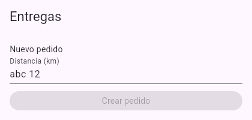

### Lista de pedidos (ListView + ListTile)

`ListView.builder` arma una fila por cada folio. Al tocar la segunda salió abajo el aviso "Elegiste A1B2C3D4".

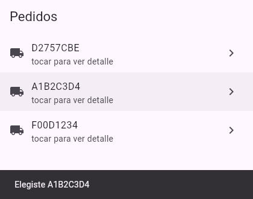

### Row + Expanded

Con `Expanded`, el folio toma el espacio libre y **dron** queda hasta la derecha.

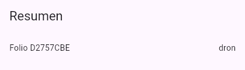

Sin `Expanded` y con un folio muy largo, el texto ya no cabe. En modo debug aparece la franja amarilla con negro, y **dron** no se alcanza a ver.

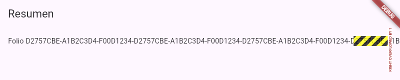

### Switch

`SwitchListTile` guarda `urgente` en el estado. Al tocarlo pasó a encendido.

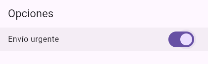

### DropdownButton

Empieza en **Motocicleta**. Al abrirlo salen tres opciones y al elegir **Dron** se actualiza el valor.

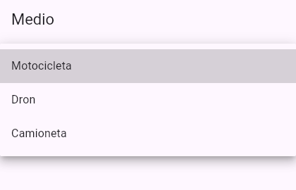

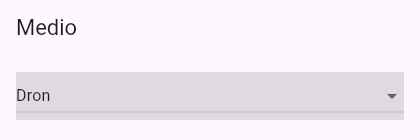

### AlertDialog

El botón abre un diálogo con **Cancelar** y **Sí**. El resultado se espera con `await`; al responder **Sí** sale el aviso "Aquí iría el HTTP".

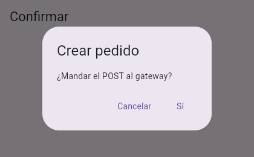

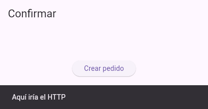

### Navigator

Al tocar el folio, `Navigator.push` abre la pantalla de detalle y le pasa el folio. Esa pantalla trae la flecha de regreso y el botón **Volver**, que usa `Navigator.pop`.

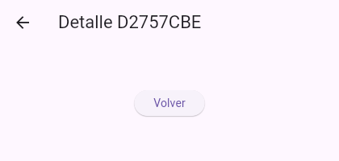

### CircularProgressIndicator

Al presionar **Crear (simulado)** aparece el círculo de carga y el botón se deshabilita, para no mandar dos veces. Después de 2 segundos sale el folio.

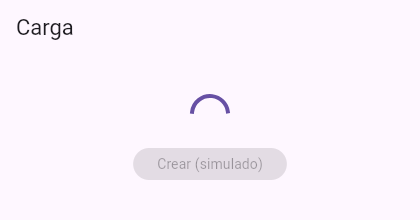

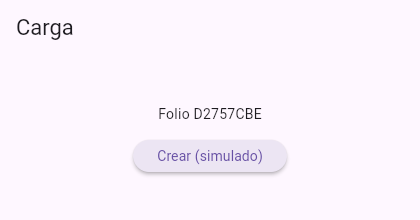

### Formulario con controladores (TextEditingController)

Cada campo tiene su controlador, y con `.text` se lee lo escrito al presionar **Crear**. Se capturó 12 de distancia y 0.5 de peso, y el aviso mostró los dos valores. En `dispose` se liberan los controladores cuando la pantalla se cierra.

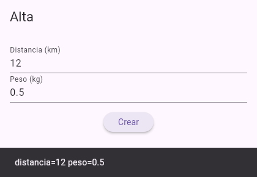

### Validar antes de mandar (Form + TextFormField)

Al presionar **Validar** con el campo vacío apareció "Obligatorio" en rojo y no salió ningún aviso. Con 12 el formulario pasó y salió "Formulario OK". Aquí sí se revisa lo escrito, a diferencia del esqueleto, donde el teclado numérico no impedía nada. De todos modos el servidor tiene que volver a validar.

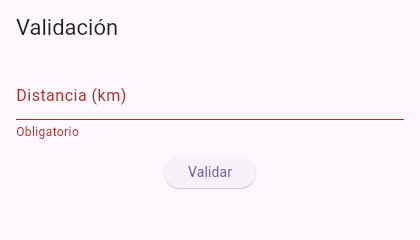

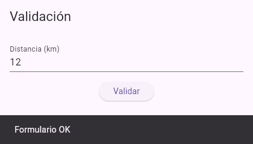

---

## Preguntas cortas

**1. ¿Qué problema de mantenimiento ataca Flutter al existir web y móvil en el mismo producto?**

El de tener la misma pantalla programada varias veces. Si cambia un dato del backend o una validación visual, con proyectos separados hay que corregirlo en cada uno y es fácil que queden distintos. Con Flutter hay un solo código en Dart para web, Android e iOS.

**2. ¿Por qué Flutter dibuja sus propios controles en lugar de usar solo los nativos del sistema?**

Para que la app se vea y se comporte igual en todas las plataformas. Si dependiera de los controles de cada sistema, cambiarían según el dispositivo y su versión, y habría que ajustar cada caso.

**3. ¿En qué se diferencian un `StatelessWidget` y un `StatefulWidget`?**

El primero solo muestra lo que recibe. El segundo tiene un objeto `State` con datos que cambian, y al modificarlos con `setState` se vuelve a ejecutar `build`. En los ejemplos, el folio es Stateless y el contador es Stateful.

**4. Si `flutter doctor` se queja del toolchain de Android pero Chrome está bien, ¿pueden empezar la clase de widgets igual? ¿Qué no podrán hacer todavía?**

Sí, los widgets se pueden practicar en Chrome. Lo que no se podrá es correr la app en un emulador o celular Android ni generar el APK.

**5. ¿Por qué un `Column` sin `Expanded` a veces «desborda» la pantalla cuando meten muchos hijos?**

Porque cada hijo pide su propio alto y el `Column` no los encoge ni hace scroll. Si la suma pasa del alto disponible, sobra contenido fuera de la pantalla. Es lo mismo que pasó con el `Row`, pero en vertical. `Expanded` reparte el espacio libre; si son muchos elementos, conviene `ListView` o `SingleChildScrollView`.

**6. ¿Qué widget usarían para mostrar muchos folios con scroll, y cuál para avisar «pedido creado» sin cambiar de pantalla?**

`ListView.builder` con un `ListTile` por folio para la lista, y un `SnackBar` para el aviso.

**7. ¿En qué se parece el ejemplo de `CircularProgressIndicator` a una llamada real al gateway?**

El flujo es el mismo: se marca que está cargando, se espera con `await` y se actualiza la pantalla con el resultado. La diferencia es que aquí `Future.delayed` siempre contesta bien, y una llamada real puede fallar o tardar más, así que también habría que manejar el error y el tiempo de espera.
