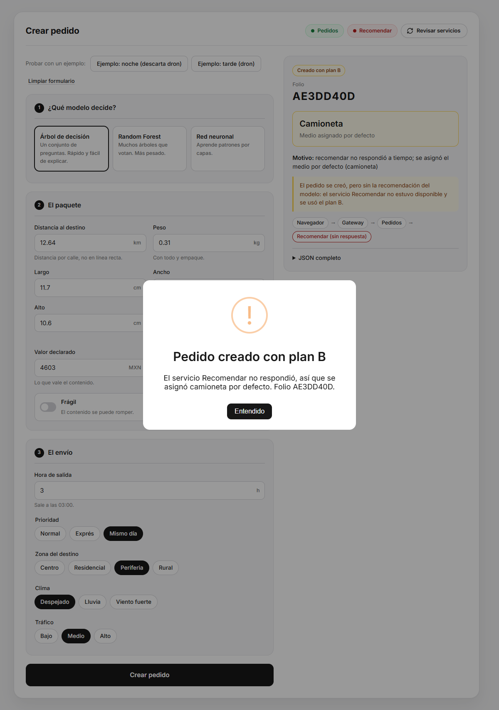
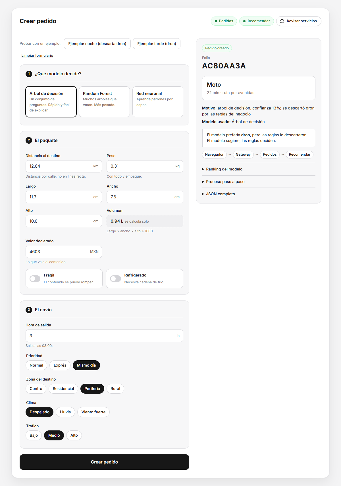
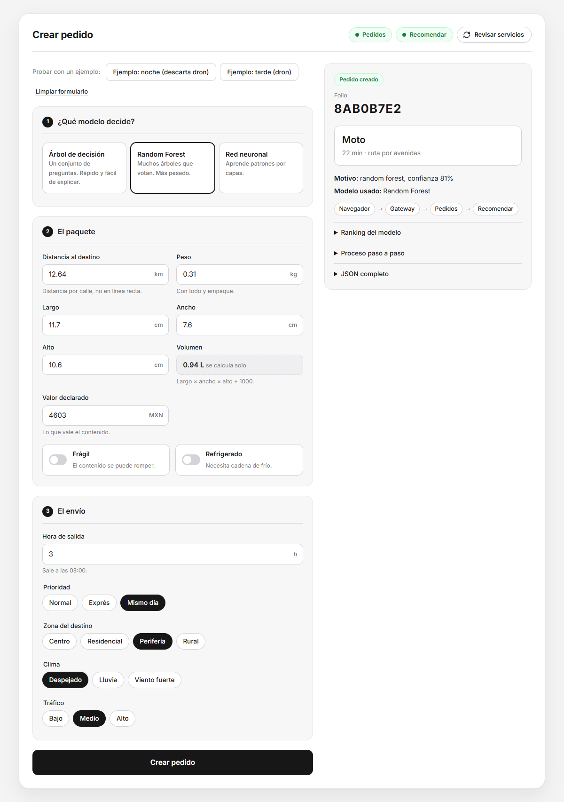
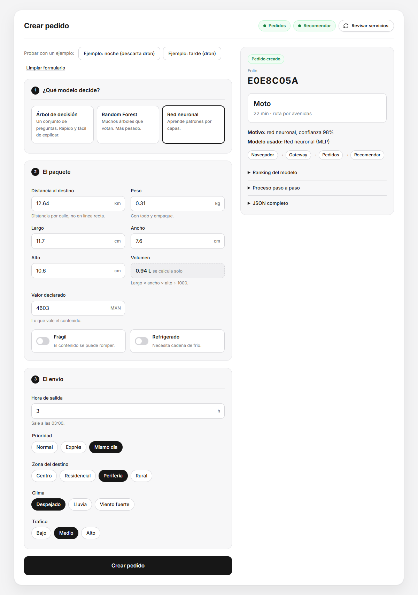

# Actividad — Microservicios con Docker

- **Nombre:** Enrique Martínez
- **Matrícula:** 22121275
- **Equipo:**

## 1. Predicción (hora 3) vs resultado (navegador)

**Predicción.** El paquete es ligero y va lejos, así que el modelo probablemente quiera dron. Como sale a las 3:00, las reglas no deberían dejarlo y quedaría la moto.

**Navegador.** Folio `F2227302`, **moto**, 22 minutos. Motivo: "árbol de decisión, confianza 13%; se descartó dron por las reglas del negocio".


**`curl` con `paquete.json`.**

```
curl -X POST http://127.0.0.1:8080/pedidos -H "Content-Type: application/json" -d @paquete.json
```

Respondió HTTP 201 en 0.03 s: folio `62FF4355`, moto, mismo motivo. El ranking del árbol fue dron 84.1%, moto 13.1%, camioneta 2.8% y bicicleta 0%.

**Comparación.** Se cumplió. La confianza de 13% es la de la moto, no la del pedido en general: es el segundo lugar del ranking, que quedó porque las reglas descartaron al primero.

## 2. docker compose ps (qué hay en cada contenedor)

```
NAME                                   IMAGE                                SERVICE      PORTS
microservicios-entregas-gateway-1      nginx:1.27-alpine                    gateway      0.0.0.0:8080->80/tcp
microservicios-entregas-pedidos-1      microservicios-entregas-pedidos      pedidos      8001/tcp
microservicios-entregas-recomendar-1   microservicios-entregas-recomendar   recomendar   8002/tcp
```

| Contenedor | Qué tiene | Tamaño de imagen |
|---|---|---|
| gateway | nginx, el `index.html` y las rutas. Es el único con puerto publicado | 73.6 MB |
| pedidos | Flask y requests. Crea el folio y guarda el pedido en memoria. No tiene scikit-learn | 202 MB |
| recomendar | Flask, joblib, pandas, scikit-learn, los tres modelos y las reglas | 717 MB |

Se comprobó con `docker compose exec pedidos pip list` que en pedidos no está scikit-learn.

## 3. Fallo al apagar recomendar (qué mostró la página o el curl)

Se apagó con `docker compose stop recomendar`.

**Predicción.** Pedidos seguiría respondiendo con el plan B (camioneta) después de unos 3 segundos.

**Página.** Mostró "Creado con plan B", folio `AE3DD40D`, camioneta, el motivo y el recorrido con "Recomendar (sin respuesta)". No se quedó en blanco.



**`curl`.** HTTP **503** en **3.96 s**, folio `2F447B4A`, `plan_b: true`, `modelo: null`.

**Salud.** `/salud/pedidos` siguió respondiendo 200. `/salud/recomendar` dio **504**, y como esa respuesta la genera nginx, llega en HTML y no en JSON.

**Otra prueba.** Con `docker compose pause recomendar` (el contenedor existe pero no contesta) el pedido tardó **3.01 s**, que es justo el tiempo de espera de pedidos. Con `stop` tardó casi un segundo más; la explicación probable es que el nombre `recomendar` deja de existir en la red y la búsqueda del nombre no cuenta igual dentro de ese tiempo.

Después de `docker compose start recomendar` los pedidos volvieron a salir con 201.

## 4. Réplicas de la etapa 5 vs esto

Las réplicas son varias copias de la misma imagen. Cada copia tiene todo el sistema y puede atender cualquier petición sola. Ayudan a repartir carga, pero sigue siendo un monolito: cualquier cambio obliga a reconstruir y reemplazar todas.

Aquí cada contenedor tiene una responsabilidad y sus propias dependencias. Pedidos no puede recomendar porque no tiene el modelo, así que lo pide por HTTP. Se puede apagar, cambiar o reconstruir uno sin tocar los otros, y eso se vio con el plan B.

## 5. Camino: navegador → … → modelo (red vs import)

1. Navegador → gateway (`:8080`): **red**
2. Gateway → pedidos (`pedidos:8001/pedidos`): **red**
3. Pedidos → recomendar (`recomendar:8002/sugerir`): **red**
4. Recomendar → reglas y adaptador del modelo: **import**
5. Adaptador → archivo `.joblib`: se lee del disco con `joblib.load` y queda en memoria

En el monolito solo el primer paso era por red. Cada salto nuevo puede fallar o tardar, por eso pedidos necesita tiempo de espera y plan B.

## 6. Si solo cambia el .joblib, ¿qué reconstruyen?

Solo recomendar, porque el modelo se copia dentro de esa imagen:

```
docker compose up -d --build recomendar
```

Gateway y pedidos siguen corriendo. Mientras recomendar se reemplaza, los pedidos que lleguen caerían en el plan B. En el monolito el modelo va en la única imagen, así que se reconstruye toda la aplicación.

## 7. Dos límites de esta práctica antes de producción

1. **Los pedidos viven en una lista en memoria.** Si el contenedor de pedidos se reinicia se pierden, y con dos réplicas cada una tendría una lista distinta. Falta una base de datos.
2. **Los servicios usan el servidor de desarrollo de Flask** (`CMD ["python", "app.py"]`). Falta un servidor de producción como gunicorn, y además HTTPS y autenticación en el gateway.

## 8. ¿En qué se parece y en qué no el HTML al del monolito Django?

**Se parece** en los campos del paquete, el selector de modelo y la forma de mostrar medio y motivo. En los dos la decisión se toma en el servidor.

**No se parece** en quién lo entrega y a quién llama. Aquí nginx lo sirve como archivo estático y el `fetch` va a `/pedidos` del gateway; detrás hay tres procesos. Además muestra el folio, el recorrido, la salud de cada servicio y el caso del plan B, que en un monolito no tiene sentido.

## 9. Misma hora 3 con árbol, bosque y red: ¿coincidieron?

**Predicción.** Los tres terminarían en el mismo medio porque las reglas son las mismas.

| Modelo | Primera opción | Medio final | Confianza | ¿Corrigieron las reglas? |
|---|---|---|---|---|
| Árbol | dron (84.1%) | moto | 13% | Sí |
| Random Forest | moto (81%) | moto | 81% | No |
| Red neuronal | moto (98.3%) | moto | 98% | No |







**Comparación.** El medio coincidió y el motivo no. El árbol llegó a moto porque las reglas descartaron el dron; el bosque y la red ya la ponían primero (el bosque dejaba al dron en segundo con 17.3%). Una confianza más alta no demuestra que el modelo acierte más: solo se probó un paquete.
